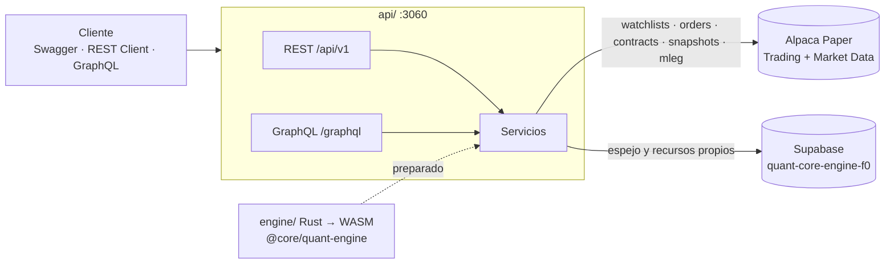

# Quant Core Engine & Market Data (F0)

Equipo F0 de la plataforma de inversiones: **motor matemático analítico central** y **pipeline de
datos de mercado**.

| Carpeta | Qué es | Estado |
|---|---|---|
| [`api/`](api) | 4 APIs CRUD (REST + GraphQL) conectadas a **Alpaca** y persistidas en **Supabase** · puerto 3060 | En uso |
| [`supabase/migrations/`](supabase/migrations) | Esquema del proyecto Supabase `quant-core-engine-f0` | Aplicado |
| [`engine/`](engine) | Motor en Rust → WebAssembly: Black-Scholes, binomial americano, griegas, IV, Reg T / SPAN, Monte Carlo | Preparado |
| [`packages/quant-engine/`](packages/quant-engine) | `@core/quant-engine`: contrato síncrono en JS sobre el `.wasm` | Preparado |
| [`openspec/`](openspec) | Contratos OpenSpec de las APIs y del motor | — |



## Las 4 APIs

| # | Recurso | Alpaca | GET | POST | PUT / PATCH | DELETE |
|---|---|---|---|---|---|---|
| 1 | `/api/v1/watchlists` | `/v2/watchlists` | lista, detalle | crear, agregar símbolo | PUT nombre + símbolos | borrar, quitar símbolo |
| 2 | `/api/v1/orders` | `/v2/orders` | lista, detalle | enviar orden | PATCH reemplazar | cancelar una / todas |
| 3 | `/api/v1/option-chains` | `/v2/options/contracts` + `/v1beta1/options/snapshots` | lista, cadena con IV y griegas | seguir + ingestar, `/{id}/refresh` | PUT filtros + re-ingesta | dejar de seguir |
| 4 | `/api/v1/strategies` | contratos OCC + orden `mleg` | lista, detalle valorado en vivo | crear, `/{id}/submit` | PUT (solo draft) | borrar (cancela si se envió) |

Todas tienen su equivalente en **GraphQL** (`/graphql`) y están documentadas en **Swagger** (`/api-docs`).

## Cómo correrlo

```bash
cd quant-core-engine/api
npm install
cp .env.example .env     # y llena las 4 variables de abajo
npm run dev              # http://localhost:3060
npm run smoke            # en otra terminal: recorre todo el CRUD de las 4 APIs
```

| Variable | De dónde sale |
|---|---|
| `ALPACA_KEY_ID`, `ALPACA_SECRET_KEY` | [app.alpaca.markets](https://app.alpaca.markets) → cuenta **Paper** → *API Keys* → *Generate New Keys* |
| `SUPABASE_URL` | `https://baefggsjvchvnuudlpbl.supabase.co` |
| `SUPABASE_SECRET_KEY` | Dashboard → *Project Settings* → *API Keys* → **Secret key** (`sb_secret_...`) |

`GET http://localhost:3060/` dice qué variables faltan (`missingConfig`). Sin ellas las APIs responden `503`.

## Dónde probar las APIs (sin instalar nada)

Con `npm run dev` corriendo:

| Herramienta | URL / archivo | Para qué |
|---|---|---|
| **Front F0** | https://betocw.github.io/lab-servicios-web/ · o local en http://localhost:3060/app | Demo visual de las 4 APIs: watchlists, cadena con IV/griegas, armar spreads y órdenes |
| **Swagger UI** | http://localhost:3060/api-docs | Probar cada endpoint REST con *Try it out* |
| **GraphiQL** | http://localhost:3060/graphql | Escribir queries/mutations con autocompletado |
| Colección (Insomnia v4) | [`api/insomnia/f0-collection.json`](api/insomnia/f0-collection.json) | 28 peticiones con ids encadenados; se importa en Insomnia, Postman, Bruno, Hoppscotch o Yaak |
| REST Client | [`api/requests/f0.http`](api/requests/f0.http) | Extensión de VS Code |
| MCP `f0-api` | [`mcp/f0-api-mcp.js`](mcp/f0-api-mcp.js) (registrado en `.mcp.json`) | Claude Code ejecuta la misma colección |

El front ([`web/index.html`](web/index.html), un solo archivo sin dependencias) se publica solo en
GitHub Pages con cada push a `main` que toque `quant-core-engine/web/` (workflow
`.github/workflows/pages.yml`). Pages solo sirve el HTML: la API con las llaves sigue corriendo en
tu máquina y el front le habla a `http://localhost:3060` (editable arriba a la derecha). Si Chrome
pregunta por *acceso a la red local*, permítelo.

La colección se regenera con `node scripts/buildCollection.js` (fechas de vencimiento relativas a hoy).
Al importarla, ejecuta las carpetas en orden: el *POST crear* de cada una guarda el id en el
environment y las demás peticiones lo reutilizan.

### MCP `f0-api`
Servidor MCP sin dependencias. Herramientas: `f0_status`, `f0_list_requests`, `f0_run_request`,
`f0_run_all`, `f0_call`, `f0_graphql`, `f0_reload_collection`. Claude Code lo carga desde
`.mcp.json` en la raíz del repo (hay que aprobarlo la primera vez y reiniciar la sesión).

## Base de datos (Supabase)

Proyecto **quant-core-engine-f0** (us-east-1, organización CocaCola).
Tablas: `watchlists`, `orders`, `option_chains`, `option_quotes`, `strategies`, `strategy_legs`,
todas con RLS (solo el backend con la llave secreta las lee y escribe).

## Motor (preparado, aún sin consumidores)

```bash
cd engine && cargo test --release                      # 14 pruebas
cd ../packages/quant-engine && npm run build && npm test   # compila a WASM + 4 pruebas JS
```

```js
import { blackScholes, binomial, impliedVol, spanMargin } from '@core/quant-engine';
blackScholes([{ type: 'call', spot: 42, strike: 40, t: 0.5, rate: 0.1, vol: 0.2 }]); // price ≈ 4.7594
```

## Agentes y skills de Claude Code

En [`.claude/`](../.claude) del repo:

| Agente | Para qué |
|---|---|
| `alpaca-integrator` | Endpoints y errores de Alpaca |
| `supabase-dba` | Tablas, RLS y migraciones |
| `quant-math-reviewer` | Validar la matemática del motor |
| `api-contract-guardian` | REST ⇄ GraphQL ⇄ OpenAPI ⇄ OpenSpec alineados |

| Skill | Para qué |
|---|---|
| `alpaca-api` | Referencia de endpoints de Alpaca en uso |
| `supabase-migrate` | Escribir, aplicar y verificar migraciones |
| `f0-smoke-test` | Correr el CRUD completo de las 4 APIs |
| `quant-engine-build` | Compilar el WASM y correr pruebas |
| `openspec-change` | Proponer cambios de contrato |
