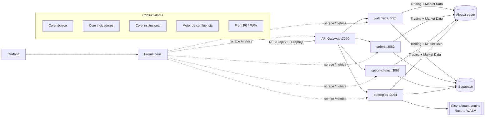

# 04 APIs, cores y motor de confluencia

> Guía F0 · Quant Core Engine & Market Data. Requisito: notas `01`–`03`.

Objetivo: entender cómo encaja F0 en la plataforma completa — los 5 *cores* de análisis, el motor
de confluencia que combina sus señales y los 3 modos de seleccionar estrategia ↔ empresa — y cómo
los demás equipos consumen nuestras APIs.

> **Alcance honesto.** En este repositorio están implementadas **solo las piezas de F0**: las 4 APIs
> (watchlists, orders, option-chains, strategies), el motor de riesgo Rust/WASM y la conversión a
> microservicios. Los 5 cores y el motor de confluencia **no están aquí**: se describen como
> **contrato** (qué esperan recibir y qué entregan) y como **consumo** de nuestras APIs. Todo
> nombre de campo de los cores en esta nota es una propuesta de contrato, no código existente.

---

## 04.01 Los 5 cores de análisis

### 04.01.1 Qué es un core
Un servicio que analiza una empresa (o ETF) desde un ángulo y produce una **señal normalizada**.
Contrato común propuesto para que el motor de confluencia pueda combinarlas:

```json
{
  "symbol": "AAPL",
  "core": "tecnico",
  "score": 0.62,          // -1 (muy bajista) … +1 (muy alcista)
  "confidence": 0.8,      // 0 … 1: qué tan fiable es la señal con los datos disponibles
  "horizonDays": 30,
  "asOf": "2026-11-03T20:00:00Z",
  "evidence": { "rsi14": 41.2, "sma50OverSma200": true }
}
```

### 04.01.2 Core técnico
- **Analiza**: precio y volumen (tendencia, soportes/resistencias, patrones).
- **Necesita de F0**: precio del subyacente y barras históricas vía Alpaca Market Data.
- **Señal**: tendencia (cruces de medias), momentum, ruptura de niveles.

### 04.01.3 Core fundamental
- **Analiza**: estados financieros (ingresos, márgenes, deuda, flujo), valuación (P/E, EV/EBITDA),
  calendario de resultados.
- **Fuente**: proveedores de fundamentales (no Alpaca).
- **Señal**: empresa barata/cara vs. su sector, calidad del balance. Importante para opciones: un
  reporte de resultados dentro del vencimiento eleva la IV.

### 04.01.4 Core institucional
- **Analiza**: flujo de "dinero grande": tenencias 13F, compras de *insiders* (Form 4), flujo de
  opciones inusual (volumen ≫ open interest), *dark pools*.
- **Necesita de F0**: volumen y open interest de las cadenas de opciones (`openInterest` en
  `GET /option-chains/{id}`).

### 04.01.5 Core de indicadores
- **Analiza**: indicadores cuantitativos sobre precio y volatilidad: RSI, MACD, Bandas de
  Bollinger, ATR, **IV rank / IV percentile**, *skew*, *term structure*.
- **Necesita de F0**: `impliedVolatility` y griegas por contrato (cadenas) y el motor
  `@core/quant-engine` (`impliedVol`, `blackScholes`) para recalcular IV o griegas.
- **Por qué importa para opciones**: IV alta favorece vender prima (créditos); IV baja, comprarla
  (débitos).

### 04.01.6 Core de noticias
- **Analiza**: titulares y comunicados; extrae **sentimiento** (positivo/negativo) y eventos
  (fusiones, demandas, guías de resultados).
- **Fuente**: feeds de noticias (Alpaca tiene un endpoint de noticias; no lo usamos todavía).
- **Señal**: sentimiento ponderado por recencia y relevancia.

---

## 04.02 Motor de confluencia

### 04.02.1 Idea
"Confluencia" = varias señales independientes apuntan al mismo lado. Una sola señal es ruido;
técnico + institucional + indicadores alcistas a la vez es una tesis.

### 04.02.2 Cómo se combinan en un score
1. **Normalizar**: cada core entrega `score ∈ [-1, 1]` y `confidence ∈ [0, 1]`.
2. **Ponderar**: pesos por core según el horizonte (técnico pesa más a corto plazo, fundamental a
   largo plazo).
3. **Agregar**:

   ```
   S = Σ (w_i · c_i · s_i) / Σ (w_i · c_i)      s_i = score, c_i = confidence, w_i = peso
   ```

4. **Medir acuerdo**: `acuerdo = |Σ signo(s_i)| / n`. Un score alto con poco acuerdo se marca como
   débil.
5. **Clasificar**: dirección (alcista / neutral / bajista) y régimen de volatilidad (IV rank del
   core de indicadores).

```js
// Pseudocódigo del contrato (no existe en este repo)
function confluencia(señales, pesos) {
  const num = señales.reduce((a, s) => a + pesos[s.core] * s.confidence * s.score, 0);
  const den = señales.reduce((a, s) => a + pesos[s.core] * s.confidence, 0);
  const acuerdo = Math.abs(señales.reduce((a, s) => a + Math.sign(s.score), 0)) / señales.length;
  return { score: den ? num / den : 0, acuerdo };
}
```

### 04.02.3 De score a estrategia
| Dirección \ IV | IV baja (comprar prima) | IV alta (vender prima) |
|---|---|---|
| Alcista | Long call, bull call spread (débito) | Bull put spread (crédito), cash-secured put |
| Neutral | Calendar, long straddle (si se espera evento) | Iron condor, short strangle cubierto |
| Bajista | Long put, bear put spread (débito) | Bear call spread (crédito) |

Cada estrategia resultante cabe en la API de estrategias de F0 (1 a 4 piernas). El estudio
completo de estrategias está en [`../ESTUDIO-ESTRATEGIAS.md`](../ESTUDIO-ESTRATEGIAS.md).

---

## 04.03 Tres modos de selección estrategia ↔ empresa

### 04.03.1 Empresa → estrategia
El usuario elige la empresa (`AAPL`); la plataforma corre los 5 cores, calcula la confluencia y
**sugiere la estrategia** de la tabla 04.02.3.
Llamadas a F0: `POST /option-chains` (cadena de AAPL) → elegir strikes por delta →
`POST /strategies` → `GET /strategies/{id}/risk`.

### 04.03.2 Estrategia → empresa
El usuario elige la estrategia ("quiero vender iron condors"); la plataforma **busca empresas**
que cumplan sus condiciones (neutral + IV alta + opciones líquidas).
Llamadas a F0: recorre una watchlist (`GET /watchlists/{id}`), ingesta cadenas y filtra por
`impliedVolatility`, `openInterest` y spread `ask − bid`.

### 04.03.3 Automático por score
La plataforma recorre un universo (p. ej. una watchlist de 50 símbolos), calcula la confluencia de
todos, toma los de `|score|` más alto con buen acuerdo, asigna la estrategia de la matriz, la
**valida con el motor de riesgo** (pérdida máxima, probabilidad de ganancia del Monte Carlo) y la
deja en `draft` para que un humano la envíe con `/submit`.

| Modo | Entrada del usuario | Salida |
|---|---|---|
| Empresa → estrategia | Ticker | Estrategia sugerida + riesgo |
| Estrategia → empresa | Tipo de estrategia | Lista de tickers candidatos |
| Automático | Universo y reglas | Ranking + estrategias en `draft` |

---

## 04.04 Qué aporta F0

### 04.04.1 Datos de mercado
- Watchlists sincronizadas con Alpaca (`/api/v1/watchlists`).
- Precio del subyacente (snapshot de acciones) dentro del análisis de riesgo.

### 04.04.2 Cadenas de opciones con IV y griegas
`POST /api/v1/option-chains` ingesta hasta 300 contratos (filtros por vencimiento, tipo y strike)
desde `/v2/options/contracts` + `/v1beta1/options/snapshots` y los guarda en Supabase. Cada
contrato trae `bid`, `ask`, `mid`, `last`, `openInterest`, `impliedVolatility`, `delta`, `gamma`,
`theta`, `vega`, `rho`.

### 04.04.3 Estrategias y ejecución
`/api/v1/strategies`: arma 1–4 piernas validadas contra Alpaca, las valora en vivo y las envía como
orden `mleg` (ver nota `03.05`). `/api/v1/orders`: órdenes simples.

### 04.04.4 Motor de riesgo
`GET /api/v1/strategies/{id}/risk` corre `@core/quant-engine` (Rust → WASM) con datos reales:
Monte Carlo del P&L (VaR, CVaR, probabilidad de ganancia), matriz precio × volatilidad, márgenes
Reg T y SPAN, griegas del portafolio y precio del modelo vs. mid. Otros equipos también pueden
importar el motor directo: `import { blackScholes } from '@core/quant-engine'`.

---

## 04.05 Cómo consumen los demás equipos nuestras APIs

### 04.05.1 REST
Documentado en Swagger (`/api-docs`). Ejemplo desde otro servicio:
```js
const base = 'http://localhost:3060/api/v1';
const chain = await fetch(`${base}/option-chains`, {
  method: 'POST',
  headers: { 'content-type': 'application/json' },
  body: JSON.stringify({ underlying: 'AAPL', expiration_from: '2026-12-01', expiration_to: '2026-12-31' }),
}).then((r) => r.json());
const detalle = await fetch(`${base}/option-chains/${chain.id}?type=put`).then((r) => r.json());
```
Errores: `{ status, message, details? }` con el código HTTP real (400 validación, 404, 409
estado, 503 configuración, y el status de Alpaca cuando viene de allá).

### 04.05.2 GraphQL
Un solo request trae exactamente los campos que el core necesita (útil para el core de
indicadores, que solo quiere IV y delta):
```graphql
query {
  optionChains(underlying: "AAPL") {
    id underlyingPrice
    quotes(type: "put") { symbol strike expiration impliedVolatility delta openInterest }
  }
  strategyRisk(id: "<id-de-estrategia>", paths: 50000) { spot probProfit var95 cvar95 regT span delta theta }
}
```
Cada operación REST tiene su query/mutation equivalente (paridad exigida en
`openspec/specs/market-data-api/spec.md`); los errores llevan `extensions.status`.

### 04.05.3 ¿Cuál usar?
| Necesidad | Usa |
|---|---|
| Escribir (crear estrategia, enviar orden) | REST (verbos y códigos HTTP claros) |
| Leer muchos campos/recursos en una vuelta | GraphQL |
| Cálculo puro sin red | Importar `@core/quant-engine` |

---

## 04.06 Arquitectura de microservicios

### 04.06.1 Diagrama
Un proceso por API detrás de un gateway, cada uno con
`/health` y `/metrics` (Prometheus), orquestado con `docker-compose.yml` y monitoreado con
Prometheus + Grafana (`quant-core-engine/monitoring/`). Código en `api/src/microservices/`.



### 04.06.2 Responsabilidades
| Servicio | Puerto | Rutas que atiende | Tablas Supabase |
|---|---|---|---|
| gateway | 3060 | Entrada única: reenvía por prefijo; sirve `/graphql`, `/api-docs`, `/app`, `/health` agregado, `/metrics` | — |
| watchlists | 3061 | `/api/v1/watchlists` | `watchlists` |
| orders | 3062 | `/api/v1/orders`, `/api/v1/account` | `orders` |
| option-chains | 3063 | `/api/v1/option-chains` | `option_chains`, `option_quotes` |
| strategies | 3064 | `/api/v1/strategies` (+ `/risk`, `/submit`, motor WASM) | `strategies`, `strategy_legs` |

Cada servicio monta solo sus routers y reutiliza los mismos servicios (`SERVICES` en
`api/src/microservices/index.js`): la lógica vive en un solo lugar. GraphQL corre dentro del
gateway llamando a los servicios en proceso (marcado como `shortcut:` en el código).

### 04.06.3 Qué cambia para los consumidores
Nada en la URL: siguen llamando a `:3060`. El gateway reenvía con `fetch` (timeout de 30 s); si un
servicio cae, solo su API responde `503 El microservicio <x> no responde` y las demás siguen.
`GET /health` del gateway responde `200 ok` solo si los 4 servicios están `ok`; si no, `503
degraded` con el estado de cada uno.

### 04.06.4 Cómo levantarlo y verificarlo
```bash
cd quant-core-engine/api
npm run dev                            # 4 servicios + gateway como procesos separados (fork)
curl http://localhost:3060/health      # salud agregada
curl http://localhost:3061/health      # un servicio
curl http://localhost:3062/metrics     # métricas en formato Prometheus

cd .. && docker compose up -d --build  # lo mismo en contenedores + Prometheus :9090 + Grafana :3000
```
En Docker solo el gateway publica puerto (3060); los servicios se ven entre sí por nombre
(`http://orders:3062`) y Prometheus los raspa así (`monitoring/prometheus.yml`). El cambio se
documenta en OpenSpec (`openspec/changes/microservicios/`, nota `06.05`).
